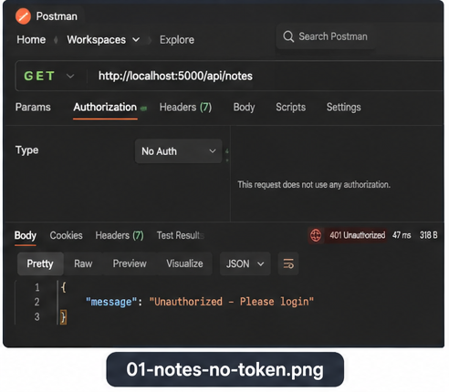
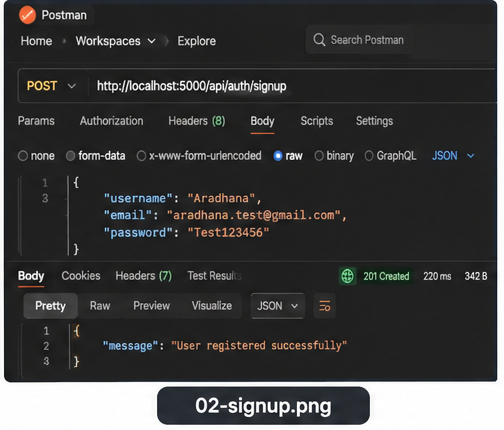
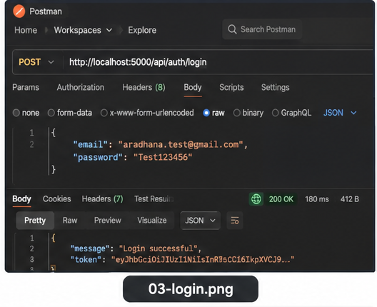
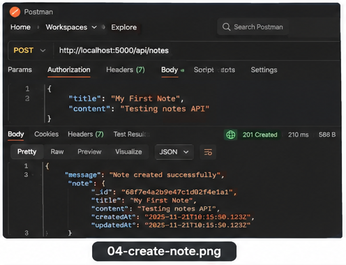
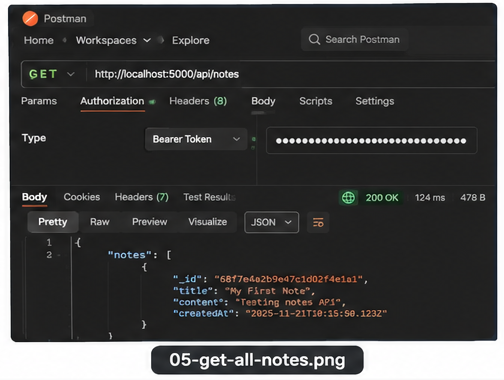
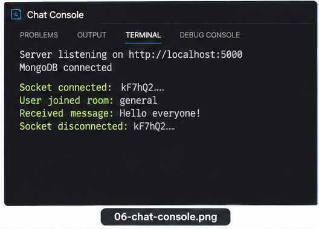
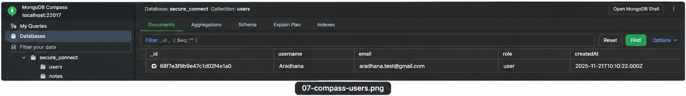

<h1 align="center">Secure-Connect</h1>

<p align="center">
  A Secure Communication Platform built with Node.js, Express.js, MongoDB, JWT Authentication, and Socket.IO.
</p>

<p align="center">
  
  
  
  
  
  
</p>

---

## Overview

**Secure-Connect** is a backend communication platform that demonstrates secure authentication, protected REST APIs, MongoDB-based data management, and real-time messaging.

The application allows users to register and log in, access protected resources using JSON Web Tokens (JWT), manage their personal notes, and exchange messages through authenticated Socket.IO connections.

## Key Features

- **User Registration:** Create user accounts with username, email, and password.
- **Secure Password Storage:** Hash passwords using bcrypt before storing them.
- **JWT Authentication:** Generate and verify JSON Web Tokens for authenticated access.
- **Role-Based Access:** Restrict administrative endpoints to users with the admin role.
- **Protected User Profile:** Retrieve profile information using a valid access token.
- **Personal Notes Management:** Create, view, update, and delete notes belonging to the authenticated user.
- **Real-Time Communication:** Exchange messages through Socket.IO chat rooms.
- **Socket Authentication:** Verify JWTs when clients establish Socket.IO connections.
- **MongoDB Integration:** Store users and notes persistently in MongoDB.
- **Event-Driven Programming:** Use Node.js EventEmitter to handle application events.

## Technology Stack

| Technology | Purpose |
|---|---|
| JavaScript | Application programming language |
| Node.js | Server-side JavaScript runtime |
| Express.js | REST API framework |
| MongoDB | NoSQL database |
| MongoDB Node.js Driver | Database connectivity and operations |
| bcrypt | Password hashing |
| JSON Web Token | Authentication and authorization |
| Socket.IO | Real-time, bidirectional communication |
| dotenv | Environment variable configuration |
| Postman | API testing |
| MongoDB Compass | Database inspection |

## Project Structure

```text
Secure-Connect/
├── config/
│   └── db.js
├── events/
│   └── appEvents.js
├── middleware/
│   └── authMiddleware.js
├── routes/
│   ├── authRoutes.js
│   └── noteRoutes.js
├── screenshorts/
│   ├── 01-notes-no-token.png
│   ├── 02-signup.png
│   ├── 03-login.png
│   ├── 04-create-note.png
│   ├── 05-get-all-notes.png
│   ├── 06-chat-console.png
│   └── 07-compass-users.png
├── .gitignore
├── package.json
├── package-lock.json
├── README.md
└── server.js
```

## Getting Started

Follow these steps to run Secure-Connect on your local machine.

### Prerequisites

Make sure you have the following installed:

- [Node.js](https://nodejs.org/)
- npm (included with Node.js)
- [MongoDB Atlas](https://www.mongodb.com/cloud/atlas) or a local MongoDB server
- [Postman](https://www.postman.com/) for API testing (optional)
- [MongoDB Compass](https://www.mongodb.com/products/tools/compass) for database inspection (optional)

### Installation

**1. Clone the repository**

```bash
git clone https://github.com/aradhana-bit/Secure-Connect.git
```

**2. Navigate to the project directory**

```bash
cd Secure-Connect
```

**3. Install dependencies**

```bash
npm install
```

**4. Configure environment variables**

Create a `.env` file in the root directory and add the following configuration:

```env
PORT=5000
MONGODB_URI=your_mongodb_connection_string
DB_NAME=secure_connect
JWT_SECRET=your_long_random_secret
JWT_EXPIRES_IN=1h
```

Replace the placeholder values with your actual MongoDB connection string and a strong, private JWT secret. Do not commit your `.env` file to GitHub.

**5. Start the application**

For normal execution:

```bash
npm start
```

For development with Node.js watch mode:

```bash
npm run dev
```

Once the database connection is successful, the server starts at:

```text
http://localhost:5000
```

## API Documentation

**Base URL:** `http://localhost:5000`

### 1. Authentication Routes

| Method | Endpoint | Description |
|---|---|---|
| POST | `/api/auth/signup` | Register a new user |
| POST | `/api/auth/login` | Log in an existing user and receive a JWT |

**Signup request body**

```json
{
  "username": "your_username",
  "email": "user@example.com",
  "password": "your_password"
}
```

**Login request body**

```json
{
  "email": "user@example.com",
  "password": "your_password"
}
```

### 2. Protected User Routes

| Method | Endpoint | Description |
|---|---|---|
| GET | `/api/profile` | Retrieve the authenticated user's profile |
| GET | `/api/admin` | Access the admin-only endpoint |

These routes require a valid JWT in the request header.

```http
Authorization: Bearer YOUR_JWT_TOKEN
```

The admin endpoint returns access only when the authenticated user's role is `admin`.

### 3. Notes Management Routes

All notes endpoints require authentication. Users can access and manage only their own notes.

| Method | Endpoint | Description |
|---|---|---|
| POST | `/api/notes` | Create a note |
| GET | `/api/notes` | Retrieve the authenticated user's notes |
| PUT | `/api/notes/:id` | Update a note |
| DELETE | `/api/notes/:id` | Delete a note |

**Create a note**

```json
{
  "title": "My First Note",
  "content": "Testing the Secure-Connect Notes API"
}
```

**Update a note**

```json
{
  "title": "Updated Note",
  "content": "The note has been updated"
}
```

Replace `:id` in the URL with the MongoDB ObjectId of the note. The update endpoint accepts a title, content, or both.

## Real-Time Communication

Secure-Connect uses **Socket.IO** to support real-time messaging between authenticated clients.

### Socket.IO Events

| Event | Description |
|---|---|
| `connect` | Establishes a socket connection |
| `join_room` | Joins a chat room |
| `joined_room` | Confirms the room joined by the client |
| `chat_message` | Sends and receives room messages |
| `disconnect` | Handles socket disconnection |

### Communication Workflow

1. The client establishes a Socket.IO connection and supplies a JWT through the handshake authentication object.
2. The server verifies the token before accepting the connection.
3. The authenticated user joins a chat room using `join_room`.
4. The client sends messages using `chat_message`.
5. The server broadcasts the message to clients in the selected room.
6. Application events are emitted for relevant activities, including chat messages.

## Database Structure

The application uses MongoDB with the database name `secure_connect` by default.

| Collection | Description |
|---|---|
| `users` | Stores registered user accounts |
| `notes` | Stores notes associated with their owners |

### Users Collection

- Username
- Email
- Hashed password
- User role
- Account creation timestamp

### Notes Collection

- Note title
- Note content
- Owner reference
- Creation timestamp
- Update timestamp

The application creates a unique index on user email and an index on the note owner field.

## Output Screenshots

The repository includes screenshots demonstrating the application's functionality.

### Authentication and Authorization

**Unauthorized Notes Access**



**User Registration**



**User Login**



### Notes Management

**Create Note**



**Retrieve Notes**



### Real-Time Communication

**Socket.IO Chat Console**



### Database Verification

**MongoDB Compass – Users Collection**



## Concepts Implemented

- RESTful API development
- HTTP methods and status codes
- User registration and login
- Password hashing and verification
- JWT-based authentication
- Middleware-based route protection
- Role-based authorization
- MongoDB CRUD operations
- User-specific data access
- Real-time communication with Socket.IO
- Socket connection authentication
- Event-driven programming with EventEmitter
- Environment variable management

## Project Objectives

- Understand secure backend application development.
- Implement authentication and authorization using JWT.
- Work with MongoDB for persistent data storage.
- Build protected REST API endpoints.
- Implement real-time communication using Socket.IO.
- Apply event-driven programming concepts in Node.js.

## Purpose

Secure-Connect was developed as a practical backend project to explore secure communication, authentication mechanisms, database operations, and real-time application development using modern JavaScript technologies.

---

<p align="center">
  <strong>Secure-Connect</strong><br/>
  Building secure connections through modern backend technologies.
</p>

<p align="center">
  Developed by <strong>Aradhana</strong><br/>
  <a href="https://github.com/aradhana-bit">GitHub Profile</a>
</p>
